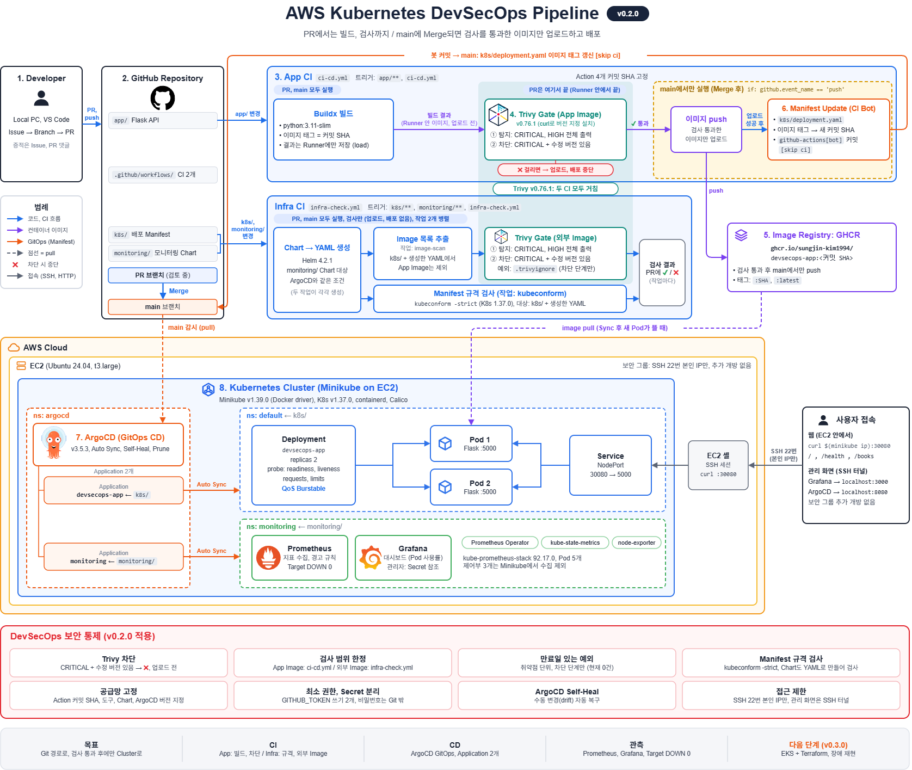

# AWS Kubernetes DevSecOps 파이프라인


### PR 단계에서 이미지 빌드 및 취약점 스캔 진행 ▶ main 브랜치에 Merge되면 검사에 통과한 이미지만 upload ▶ ArgoCD가 자동으로 배포합니다.

보안관제 직무에 종사하며 사후 대응뿐만 아니라 사전 운영의 중요성을 느껴, 직접 경험해 보고자 시작한 개인 프로젝트입니다.

> 학습용 환경입니다. 비용 관리를 위해 EC2는 미사용 시 정지, 상시 접속 주소는 없습니다.



| 영역 | 구성 |
| --- | --- |
| 인프라 | AWS EC2 (t3.large, Ubuntu 24.04), Minikube (Kubernetes `v1.37.0`, containerd, Calico) |
| CI | GitHub Actions 2개: App(`ci-cd.yml`), Infra(`infra-check.yml`) / Trivy, kubeconform |
| CD | ArgoCD `v3.5.3` (GitOps, 자동 동기화, Self-Heal), GHCR |
| 모니터링 | Prometheus, Grafana (kube-prometheus-stack, ArgoCD로 배포) |
| 앱 | Flask API, replicas 2, readiness와 liveness probe, requests와 limits |

## 파이프라인

### App: `ci-cd.yml`

| 단계 | PR | `main` Merge |
| --- | :---: | :---: |
| 이미지 빌드 (Runner에만 저장) | ✅ | ✅ |
| Trivy 탐지: CRITICAL, HIGH 전체 출력 (실패 안 함) | ✅ | ✅ |
| **Trivy 차단: CRITICAL + 수정 버전 있음 → ❌** | ✅ | ✅ |
| GHCR 업로드 (`:커밋SHA`) | — | ✅ |
| Manifest 이미지 태그 갱신 → 봇 커밋 → ArgoCD 배포 | — | ✅ |

- 차단에 걸리면 뒤 단계가 실행되지 않음 → 취약한 이미지는 GHCR에도, Cluster에도 가지 않음
- 이미지 태그는 커밋 SHA → 실행 중인 Pod가 어느 커밋에서 나왔는지 바로 추적
- 봇 커밋이 CI를 다시 돌리지 않는 이유: `k8s/`만 변경 + `[skip ci]` + `GITHUB_TOKEN`으로 한 push는 Workflow를 실행하지 않음

### Infra: `infra-check.yml`

| 작업 | 검사 대상 | 기준 |
| --- | --- | --- |
| `kubeconform` | `k8s/` + `monitoring/` Chart로 만든 YAML | Kubernetes `1.37.0` 규격, `-strict` (규격에 없는 필드도 실패) |
| `image-scan` | 위 YAML에 적힌 외부 Image | App과 같은 차단 기준 |

- Chart는 ArgoCD와 같은 조건(Helm 버전, release 이름, namespace)으로 YAML을 만든 뒤 검사 → 실제로 배포될 내용을 검사

### 배포: ArgoCD

| Application | 보는 곳 (`main`) | 설치 위치 |
| --- | --- | --- |
| `devsecops-app` | `k8s/` | `default` |
| `monitoring` | `monitoring/` (Helm Chart) | `monitoring` |

- Git과 Cluster가 다르면 자동 동기화, Cluster를 손으로 바꿔도 Git 상태로 되돌림 (Self-Heal)

## 핵심 포인트 5개

각 항목의 근거와 증적(캡처, 로그)은 연결된 Issue에 있습니다.

### 1. 이미지 차단은 업로드 전에, 지금 고칠 수 있는 CRITICAL 한정 ([#12][i12])

- **상황**: `v0.1.0`의 Trivy는 결과를 보고만 하고 배포를 막지 않았고, `main`에서는 업로드 뒤에 검사
- **결정**: CRITICAL이면서 수정 버전이 있는 취약점만 차단, 검사 위치를 GHCR 업로드 앞으로 이동 (CRITICAL, HIGH 전체는 탐지 로그로 표시)
- **근거**: 수정 버전이 없는 취약점까지 막으면 고칠 방법이 없는 채로 PR이 계속 막힘
- **검증**: `Django==3.2.0`, `nginx:1.19`를 일부러 넣어 ❌ 확인 → `git revert`로 원복

### 2. 각 PR이 자기 변경만 책임지도록 검사 범위 한정 ([PR #13 리뷰][c13])

- **상황**: Infra 검사가 App Image까지 검사 → App 취약점 때문에 상관없는 Infra PR이 CI 실패로 막혔고, 그 PR 안에서는 고칠 수도 없었음
- **결정**: App Image는 `ci-cd.yml`, 외부 Image는 `infra-check.yml`에서만 검사
- **근거**: "무시해도 되는 CI 실패"가 반복되면 다음 실패도 무시하게 됨. 특히 Infra는 Merge되면 ArgoCD가 바로 배포해서 PR의 CI 실패가 유일한 관문

### 3. 고칠 수 없는 취약점은 기한 있는 예외처리 및 이력관리 ([#16][i16])

- **상황**: 모니터링 PR에서 Grafana sidecar Image의 CRITICAL 1건으로 차단 됨, 수정된 Image는 당일에 존재하지 않았음
- **분석**: 그 취약점이 우리 설정에서 실제로 쓰이는 경로인지 소스 코드와 Chart 값으로 확인 → 쓰이지 않음으로 판단
- **결정**: 그 취약점 1건만, 차단 단계에만, 14일 만료 예외 (탐지 로그에는 계속 표시)
- **결과**: 수정 Image가 나오자 교체하고 만료 전에 예외 해제 → 현재 예외 0건

### 4. 위험한 변경은 테스트 Cluster에서 먼저 ([#18][i18] → [#19][i19])

- **상황**: 모니터링 설치 후 Target 3개 DOWN (원인: Minikube 제어부의 지표 port가 `127.0.0.1`에만 열려 있어 Prometheus가 접속 못 함)
- **테스트**: port를 여는 옵션을 메인 Cluster에 바로 넣지 않고 테스트 Cluster 생성해서 진행 → Cluster가 초기화되는 것을 확인 (내부 data가 다 날아감)
- **결정**: 옵션 변경 대신 3개를 수집 대상에서 제외 → Target DOWN 0개
- **근거**: 초기화 위험이 있고, EKS에서는 제어부를 AWS가 운영해 이 방식을 어차피 쓰지 않음

### 5. Action은 커밋 SHA로 고정 ([#23][i23])

- **문제**: Action을 버전 태그(`@v4`)로 참조 → 태그는 가리키는 커밋이 바뀔 수 있음 (2026-03 [trivy-action 태그 덮어쓰기 공격][ghsa])
- **결정**: 두 Workflow의 Action을 모두 커밋 SHA로 고정, `trivy-action`은 제거하고 Trivy를 버전 지정으로 직접 설치
- **감수한 것**: 버전이 자동으로 올라가지 않음 → 1인 운영이라 수동 갱신, 규모가 커지면 Dependabot이나 Renovate로 자동화

## 작업 방식

| 원칙 | 내용 |
| --- | --- |
| **Issue 및 PR 활용** | 사람이 하는 변경은 전부 Issue → 브랜치 → PR → Merge (Issue에 문제, 원인, 선택지, 할 일 기록) |
| **작업 이력 및 결과 증적을 남김** | 할 일마다 캡처와 설명을 가능한 Issue 및 PR 댓글에 기록 (민감정보 유출 주의) |
| **CI 결과❌면 Merge 금지** | 브랜치 보호 아직 미적용 상태로 주의 필요 |
| **초기 구성 이후 변경은 Git으로만** | 앱, 모니터링 변경은 Git → ArgoCD로만 반영, 직접 실행하는 `kubectl`은 조회용만 |`kubectl`은 조회용만 (예외는 아래 4개) |

<details>
<summary><b>GitOps 밖에서 하는 초기 구성</b> (처음 1회, <code>v0.3.0</code>에서 Terraform으로 자동화할 대상)</summary>

| 작업 | Git으로 못 하는 이유 |
| --- | --- |
| Minikube Cluster 생성 | ArgoCD가 돌아갈 Cluster가 먼저 있어야 함 |
| ArgoCD 설치 | ArgoCD가 없는 상태에서는 ArgoCD로 설치할 수 없음 |
| Application 2개 최초 등록 | 등록 전에는 ArgoCD가 이 저장소를 모름 |
| Grafana 관리자 Secret 생성 | public 저장소라 비밀번호를 Git에 넣을 수 없음 |

</details>

<details>
<summary><b>CI 실패 테스트 5건</b></summary>

| 이슈 | 일부러 넣은 것 | 결과 | 원복 커밋 |
| --- | --- | --- | --- |
| [#10][i10] | `replicas` → `replica` (규격에 없는 필드) | kubeconform ❌ | [`e11a7f5`][e11a7f5] |
| [#12][i12] | `requirements.txt`에 `Django==3.2.0` | App 차단 ❌ (수정 가능한 CRITICAL 6건) | [`db1f015`][db1f015] |
| [#12][i12] | `k8s/` Image를 `nginx:1.19`로 | Infra 차단 ❌ (수정 가능한 CRITICAL 40건) | [`48a30d4`][48a30d4] |
| [#14][i14] | Chart 설정에 `replicas: two` | kubeconform ❌ | [`b46c4bf`][b46c4bf] |
| [#14][i14] | Grafana Image를 `9.0.0`으로 | Infra 차단 ❌ | [`f6a1c53`][f6a1c53] |

</details>


## 작업 이력

| 날짜 (KST) | 내용 | 기록 |
| --- | --- | --- |
| 2026-11-09 | Action 커밋 SHA 고정 | [#23][i23], [#24][p24] |
| 2026-11-09 | 앱 Pod requests, limits 설정 → Grafana 사용률 No data 해결 | [#21][i21], [#22][p22] |
| 2026-11-09 | 사전 테스트 후 Minikube 제어부 지표 수집 제외 → Target DOWN 0개 | [#18][i18], [#19][i19], [#20][p20] |
| 2026-11-02 ~ 07 | sidecar CRITICAL 차단 → 만료일 예외 → 수정 Image로 교체 후 해제 | [#16][i16], [#17][p17] |
| 2026-11-02 | Prometheus, Grafana 모니터링 (ArgoCD 배포, Chart도 CI 검사) | [#14][i14], [#15][p15] |
| 2026-10-27 | Trivy 차단 적용 (App, Infra 두 경로), 업로드 전 검사 | [#12][i12], [#13][p13] |
| 2026-10-25 | Infra CI 추가: kubeconform으로 Manifest 규격 검사 | [#10][i10], [#11][p11] |
| 2026-10-19 | Cluster 재구축: 메모리 3GiB → 5GiB, CNI를 Calico로 (모니터링, NetworkPolicy 대비) | [#9][i9] |
| 2026-10-19 | readiness, liveness probe 추가 | [#7][i7], [#8][p8] |
| 2026-10-14 | PR에서 CI 검사, 업로드와 배포는 `main` Merge 시에만 | [#3][i3], [#4][p4] |
| 2026-10-06 | Git 기본 설정: 키, 인증 파일 커밋 방지, 줄바꿈 LF 고정 | [#1][i1], [#2][p2] |
| 2026-09-25 ~ 27 | 초기 구축: 컨테이너화 → Kubernetes 배포 → CI → ArgoCD | [v0.1.0][rel1] |

## 버전별 변화와 다음 목표

### v0.1.0 한계 → v0.2.0에서 해결

| v0.1.0 한계 | v0.2.0 |
| --- | --- |
| Trivy가 결과만 보고하고 배포를 막지 못함 (업로드 뒤에 검사) | 업로드 전에 차단 ([#12][i12]) |
| `trivy-action@master`처럼 바뀔 수 있는 참조로 Action 사용 | Trivy 버전 지정 설치, Action 커밋 SHA 고정 ([#12][i12], [#23][i23]) |
| probe, requests, limits 없음 | readiness, liveness probe ([#7][i7]), requests, limits ([#21][i21]) |
| Workflow만 바꾸면 CI가 실행되지 않음 | PR에서 CI 검사, Workflow 파일도 실행 조건에 포함 ([#3][i3]) |
| 모니터링 없음 | Prometheus, Grafana ([#14][i14]) |

### v0.2.0 남은 한계 → v0.3.0 목표 후보

| v0.2.0 남은 한계 | v0.3.0 목표 후보 |
| --- | --- |
| Minikube 단일 노드, EC2를 끄면 전부 멈춤 | EKS + Terraform, 필요할 때만 `apply`, `destroy` |
| 초기 구성(Cluster, ArgoCD, Application 등록, Secret)과 EC2, 보안 그룹을 수동 생성 | Terraform으로 Cluster 생성부터 ArgoCD 설치, Application 등록까지 자동화 |
| `main` 브랜치 보호 없음 (CI 실패여도 Merge 가능, 규칙으로 운영) | CI 봇의 `main` push 예외 방식 고민 및 결정 |
| 장애 재현 미실시 (probe, 리소스 상한의 실제 동작 미확인) | EKS에서 장애 재현 |
| 알림 없음 (Alertmanager 끔) | 알림 채널 연결 |
| NetworkPolicy 미적용 (Calico로 적용 가능한 상태까지만) | namespace별 정책 적용 |
| 컨테이너 root 실행 (v0.1.0부터 ~) | 비root 컨테이너 |
| Flask 개발용 서버 사용 (v0.1.0부터 ~) | — |
| 직접 작성한 코드 검사(SAST) 없음 | Bandit |

---

<details>
<summary><b>저장소 구조</b></summary>

```text
.
├── app/                     # Flask API, Dockerfile
├── k8s/
│   └── deployment.yaml      # Deployment + Service, CI가 이미지 태그 갱신
├── monitoring/
│   ├── Chart.yaml           # kube-prometheus-stack 버전 고정
│   ├── values.yaml          # 기본값에서 바꾼 설정만
│   └── .trivyignore         # Trivy 예외 목록 (만료일 포함, 현재 0건)
├── .github/workflows/
│   ├── ci-cd.yml            # App CI: 빌드 → Trivy 차단 → (main) 업로드, 태그 갱신
│   └── infra-check.yml      # Infra CI: kubeconform + 외부 Image Trivy 차단
├── argocd-app.yaml          # ArgoCD Application: k8s/ → default
└── argocd-monitoring.yaml   # ArgoCD Application: monitoring/ → monitoring
```

</details>

<details>
<summary><b>재현 방법</b></summary>

검증 환경: AWS EC2 t3.large, Ubuntu 24.04 / 준비: Docker, kubectl, Minikube `v1.39.0`

```bash
# 0) 저장소 받기
git clone https://github.com/sungjin-kim1994/aws-k8s-cloud-platform-devsecops.git
cd aws-k8s-cloud-platform-devsecops

# 1) Cluster 생성
minikube start -p minikube-v2-5g-calico --driver=docker --container-runtime=containerd \
  --kubernetes-version=v1.37.0 --cni=calico --memory=5g
minikube profile minikube-v2-5g-calico

# 2) ArgoCD 설치 (버전을 주소에 고정)
kubectl create namespace argocd
kubectl apply -n argocd --server-side --force-conflicts \
  -f https://raw.githubusercontent.com/argoproj/argo-cd/v3.5.3/manifests/install.yaml

# 3) Application 2개 등록, 이후 배포는 ArgoCD가 main 기준으로 진행
kubectl apply -f argocd-app.yaml
kubectl apply -f argocd-monitoring.yaml

# 4) Grafana 관리자 Secret (비밀번호는 화면과 명령 기록에 남기지 않음)
until kubectl get namespace monitoring >/dev/null 2>&1; do sleep 5; done
kubectl create secret generic grafana-admin -n monitoring \
  --from-literal=admin-user=admin \
  --from-literal=admin-password="$(openssl rand -base64 24)"

# 5) 확인
kubectl get applications -n argocd                  # devsecops-app, monitoring: Synced, Healthy
curl http://$(minikube ip):30080/health             # {"status":"healthy"}
```

Grafana, ArgoCD 화면은 보안 그룹에 포트를 추가로 열지 않고 SSH 터널과 `kubectl port-forward`로 접속합니다.

</details>

[rel1]: https://github.com/sungjin-kim1994/aws-k8s-cloud-platform-devsecops/releases/tag/v0.1.0
[rel2]: https://github.com/sungjin-kim1994/aws-k8s-cloud-platform-devsecops/releases/tag/v0.2.0
[i3]: https://github.com/sungjin-kim1994/aws-k8s-cloud-platform-devsecops/issues/3
[p4]: https://github.com/sungjin-kim1994/aws-k8s-cloud-platform-devsecops/pull/4
[i7]: https://github.com/sungjin-kim1994/aws-k8s-cloud-platform-devsecops/issues/7
[p8]: https://github.com/sungjin-kim1994/aws-k8s-cloud-platform-devsecops/pull/8
[i9]: https://github.com/sungjin-kim1994/aws-k8s-cloud-platform-devsecops/issues/9
[i10]: https://github.com/sungjin-kim1994/aws-k8s-cloud-platform-devsecops/issues/10
[p11]: https://github.com/sungjin-kim1994/aws-k8s-cloud-platform-devsecops/pull/11
[i12]: https://github.com/sungjin-kim1994/aws-k8s-cloud-platform-devsecops/issues/12
[p13]: https://github.com/sungjin-kim1994/aws-k8s-cloud-platform-devsecops/pull/13
[c13]: https://github.com/sungjin-kim1994/aws-k8s-cloud-platform-devsecops/pull/13#issuecomment-6430323684
[i14]: https://github.com/sungjin-kim1994/aws-k8s-cloud-platform-devsecops/issues/14
[p15]: https://github.com/sungjin-kim1994/aws-k8s-cloud-platform-devsecops/pull/15
[i16]: https://github.com/sungjin-kim1994/aws-k8s-cloud-platform-devsecops/issues/16
[p17]: https://github.com/sungjin-kim1994/aws-k8s-cloud-platform-devsecops/pull/17
[i18]: https://github.com/sungjin-kim1994/aws-k8s-cloud-platform-devsecops/issues/18
[i19]: https://github.com/sungjin-kim1994/aws-k8s-cloud-platform-devsecops/issues/19
[p20]: https://github.com/sungjin-kim1994/aws-k8s-cloud-platform-devsecops/pull/20
[i21]: https://github.com/sungjin-kim1994/aws-k8s-cloud-platform-devsecops/issues/21
[p22]: https://github.com/sungjin-kim1994/aws-k8s-cloud-platform-devsecops/pull/22
[i23]: https://github.com/sungjin-kim1994/aws-k8s-cloud-platform-devsecops/issues/23
[p24]: https://github.com/sungjin-kim1994/aws-k8s-cloud-platform-devsecops/pull/24
[ghsa]: https://github.com/aquasecurity/trivy/security/advisories/GHSA-69fq-xp46-6x23
[e11a7f5]: https://github.com/sungjin-kim1994/aws-k8s-cloud-platform-devsecops/commit/e11a7f5e85cf2256ee7b30e320c2e182ad567ae0
[db1f015]: https://github.com/sungjin-kim1994/aws-k8s-cloud-platform-devsecops/commit/db1f0156679fb5637a0c73af960b3b7a807ea706
[48a30d4]: https://github.com/sungjin-kim1994/aws-k8s-cloud-platform-devsecops/commit/48a30d4fcfbc7cd753fc406a362bcfe225a175e3
[b46c4bf]: https://github.com/sungjin-kim1994/aws-k8s-cloud-platform-devsecops/commit/b46c4bf67e7d346a901d2e61c180c5cf454ab786
[f6a1c53]: https://github.com/sungjin-kim1994/aws-k8s-cloud-platform-devsecops/commit/f6a1c532b3c5e051dc397d120c2d155984b104a6
[i1]: https://github.com/sungjin-kim1994/aws-k8s-cloud-platform-devsecops/issues/1
[p2]: https://github.com/sungjin-kim1994/aws-k8s-cloud-platform-devsecops/pull/2