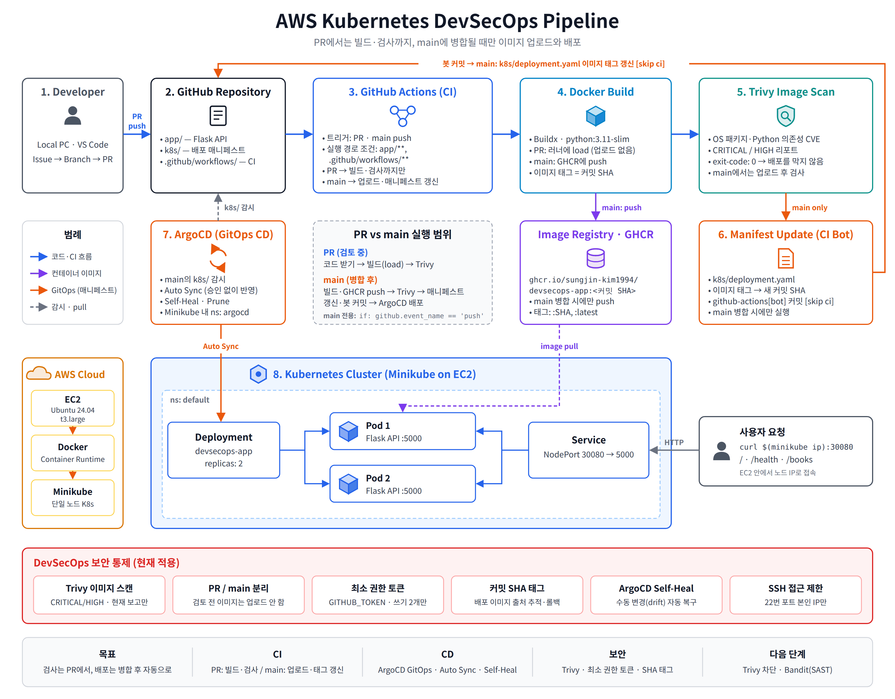

# AWS · Kubernetes DevSecOps 파이프라인

[](https://github.com/sungjin-kim1994/aws-k8s-cloud-platform-devsecops/actions/workflows/ci-cd.yml)

PR을 올리면 **이미지 빌드와 취약점 검사(Trivy)까지만** 실행하고, `main`에 병합되면 **이미지 업로드 → 배포 매니페스트 갱신 → ArgoCD 자동 배포**까지 사람 손 없이 이어지는 파이프라인입니다.
AWS EC2 위 단일 노드 Kubernetes(Minikube)에 GitHub Actions(CI)와 ArgoCD(GitOps CD)를 연결했습니다.

> 학습·포트폴리오용 환경입니다. 비용 관리를 위해 EC2는 평소 정지해 두므로 상시 접속 주소는 없습니다.
>
> 파이프라인이 처음 끝까지 동작한 시점은 [`v0.1.0`][rel]으로 고정했고, 이후 변경은 Issue와 PR로 기록합니다.



## 현재 상태

| 구분 | 내용 |
| --- | --- |
| ✅ 동작 | PR: 빌드 + Trivy 검사만 실행 (이미지 업로드·배포 없음) |
| ✅ 동작 | `main` 병합: GHCR 업로드 → 매니페스트 태그 갱신 커밋 → ArgoCD 자동 배포 |
| ✅ 동작 | 이미지 태그 = 커밋 SHA → 실행 중인 파드가 어느 커밋인지 추적 가능 |
| ⚠️ 한계 | Trivy는 결과만 보고 (`exit-code: 0`) → 취약점이 있어도 병합·배포가 막히지 않음 |
| ⚠️ 한계 | 직접 작성한 코드는 검사하지 않음 (SAST 없음) |

## PR과 main에서 실행되는 범위

| 단계 | PR | main 병합 |
| --- | :---: | :---: |
| 코드 체크아웃 · Buildx 설정 | ✅ | ✅ |
| GHCR 로그인 | — | ✅ |
| 이미지 빌드 | ✅ 러너에만 저장 | ✅ GHCR 업로드 |
| Trivy 스캔 | ✅ 업로드 없이 검사 | ✅ 업로드 후 검사 |
| 매니페스트 이미지 태그 갱신 | — | ✅ |
| 봇 커밋 (→ ArgoCD가 감지해 배포) | — | ✅ |

- `main`에 병합(push)될 때만 돌아야 하는 단계에는 `if: github.event_name == 'push'` 조건을 걸었습니다.
- 워크플로우는 `app/**` 또는 `.github/workflows/**`가 바뀔 때만 실행됩니다 (실행 경로 조건).

## 작업 방식

`v0.1.0` 이후 변경은 **Issue → 브랜치 → PR → 병합** 순서로 진행합니다.

- **Issue**: 문제 / 현재 아키텍처 / 왜 문제인지 / 해결방법 / 할 일
- **브랜치**: `종류/이슈번호-요약` (예: `ci/3-pr-checks`)
- **커밋**: Conventional Commits (`ci:`, `chore:`, `docs:` …)
- **PR**: 변경 내용·영향 범위 작성 → 실행 결과를 코멘트로 검증 → 병합 (`Closes #번호`로 Issue 자동 종료)
- **라벨**: `pipeline` `security` `environment` `troubleshooting` `documentation`

## 작업 이력

| 날짜 (KST) | 내용 | 기록 |
| --- | --- | --- |
| 2026-10-14 | PR에서 CI 검사(빌드·Trivy) 실행, 업로드·배포는 `main` 병합 시에만 | [#3][i3] · [#4][p4] |
| 2026-10-06 | Git 기본 설정 파일 추가 (줄바꿈 LF 고정, 키·인증 파일 커밋 방지) | [#1][i1] · [#2][p2] |
| 2026-10-06 | 초기 완성 시점(09-27)을 `v0.1.0` Release로 고정 | [v0.1.0][rel] |
| 2026-09-25 ~ 27 | 초기 구축: 컨테이너화 → K8s 배포 → CI → Trivy·ArgoCD | 아래 토글 |

<details>
<summary>초기 구축 커밋 상세 (2026-09-25 ~ 09-27)</summary>

커밋 메시지의 `Day` 표기는 날짜가 아니라 작업 단계 이름입니다 (`Day3`·`Day4`는 같은 날).

| 커밋 시각 (KST) | 커밋 | 내용 |
| --- | --- | --- |
| 09-25 17:25 | [`a713d2f`][a713d2f] | Flask 앱 Docker 컨테이너화 |
| 09-26 06:56 | [`07e1619`][07e1619] | Kubernetes 배포 (Deployment 2 replicas + NodePort Service) |
| 09-27 00:53 | [`7f0336a`][7f0336a] | GitHub Actions 파이프라인 추가 (GHCR 빌드·푸시, 매니페스트 자동 갱신) |
| 09-27 01:08 | [`481b7ea`][481b7ea] → [`3b94d9a`][3b94d9a] | 파이프라인 트리거 테스트 → 봇 이미지 태그 갱신 |
| 09-27 03:19 | [`17a3a3d`][17a3a3d] | Trivy 스캔 스텝, ArgoCD Application 매니페스트 추가 |
| 09-27 03:31 | [`72e6d5c`][72e6d5c] → [`72ecaf0`][72ecaf0] | Trivy 포함 end-to-end 확인 → 봇 이미지 태그 갱신 |
| 09-27 06:37 ~ 07:07 | [`6c9ea74`][6c9ea74] ~ [`32f5322`][32f5322] | README 작성 (`v0.1.0` 기준 커밋) |

</details>

---

## 상세

<details>
<summary><b>저장소 구조</b></summary>

```text
.
├── app/
│   ├── app.py              # Flask API (/, /health, /books)
│   ├── requirements.txt    # flask==3.0.0
│   └── Dockerfile          # python:3.11-slim, 의존성 레이어를 먼저 복사해 빌드 캐시 활용
├── k8s/
│   └── deployment.yaml     # Deployment(replicas 2) + Service(NodePort 30080), CI가 이미지 태그 갱신
├── .github/workflows/
│   └── ci-cd.yml           # CI: PR은 빌드·검사, main은 업로드·태그 갱신까지
├── docs/images/            # README 그림
├── argocd-app.yaml         # ArgoCD Application (최초 1회 kubectl apply)
├── .gitattributes          # 텍스트 파일 줄바꿈을 LF로 고정
└── .gitignore              # 키·인증 파일(*.pem, *.key, .env), 파이썬 캐시, Windows 자동 생성 파일 제외
```

</details>

<details>
<summary><b>CI — <code>.github/workflows/ci-cd.yml</code></b></summary>

| 순서 | 스텝 (사용 액션) | 역할 | 실행 |
| --- | --- | --- | --- |
| 1 | 코드 체크아웃<br>`actions/checkout@v4` | 저장소 코드를 러너로 가져옴 | PR · main |
| 2 | GHCR 로그인<br>`docker/login-action@v3` | `GITHUB_TOKEN`으로 인증 (별도 PAT 불필요) | main |
| 3 | Buildx 설정<br>`docker/setup-buildx-action@v3` | 빌드 환경 준비 | PR · main |
| 4 | 이미지 빌드<br>`docker/build-push-action@v5` | PR: 러너에 저장 (`load`)<br>main: `:SHA`, `:latest`로 GHCR 업로드 (`push`) | PR · main |
| 5 | Trivy 스캔<br>`aquasecurity/trivy-action@master` | CRITICAL/HIGH 보고 (`exit-code: 0`) | PR · main |
| 6 | 태그 갱신<br>`sed` | `deployment.yaml`의 이미지 태그를 커밋 SHA로 교체 | main |
| 7 | 매니페스트 커밋·푸시<br>`git` | 변경 시에만 `[skip ci]` 커밋 후 푸시 | main |

설계 포인트

- **PR에서 `load`를 쓰는 이유**: PR에서는 GHCR에 올리지 않으므로, Trivy가 검사할 이미지를 러너의 Docker에 남겨 둡니다.
- **이미지 태그 전략**: 매니페스트에는 가변 태그 `latest` 대신 커밋 SHA 태그를 기록합니다. 실행 중인 이미지가 어느 커밋에서 나왔는지 바로 추적되고, 이전 SHA로 되돌리기도 쉽습니다.
- **무한 루프 방지**: 봇 커밋은 `k8s/`만 바꾸므로 실행 경로 조건에 걸리지 않고, 메시지에 `[skip ci]`도 붙습니다. 여기에 `GITHUB_TOKEN`으로 만든 푸시는 새 워크플로우 실행을 만들지 않는 GitHub 동작까지 더해 세 겹으로 막혀 있습니다.
- **권한 최소화**: 잡에는 `contents: write`(매니페스트 커밋)와 `packages: write`(GHCR 업로드)만 부여했습니다.
- **빈 커밋 방지**: `git diff --staged --quiet || git commit ...` — 태그가 이미 같으면 커밋하지 않고, 스텝도 실패하지 않습니다.

</details>

<details>
<summary><b>CD — <code>argocd-app.yaml</code></b></summary>

| 설정 | 값 | 의미 |
| --- | --- | --- |
| `source` | 이 저장소 / `main` / `k8s` | 감시 대상: `main` 브랜치의 `k8s/` 디렉터리 |
| `destination.server` | `https://kubernetes.default.svc` | ArgoCD가 설치된 같은 클러스터 |
| `destination.namespace` | `default` | 배포 네임스페이스 |
| `syncPolicy.automated` | 활성 | Git과 클러스터가 다르면 사람 승인 없이 동기화 |
| `prune` | `true` | Git에서 지운 리소스는 클러스터에서도 삭제 |
| `selfHeal` | `true` | 클러스터를 수동으로 바꿔도 Git 상태로 되돌림 |

`argocd-app.yaml`은 부트스트랩용으로 최초 1회만 `kubectl apply` 합니다. 그 뒤 애플리케이션 배포는 `kubectl apply` 없이 Git 커밋만으로 반영됩니다.

</details>

<details>
<summary><b>Kubernetes 리소스 — <code>k8s/deployment.yaml</code></b></summary>

- **Deployment `devsecops-app`**: `replicas: 2`. 파드 하나가 죽어도 나머지가 요청을 처리하고, 이미지가 바뀌면 기본 RollingUpdate 전략으로 순차 교체합니다.
- **`imagePullPolicy: Always`**: Kubernetes 배포 단계([`07e1619`][07e1619])에서는 Minikube 내부에서 직접 빌드한 로컬 이미지(`devsecops-app:v1`)를 쓰느라 `Never`였고, 이미지를 GHCR로 옮기면서([`7f0336a`][7f0336a]) `Always`로 바꿨습니다.
- **Service `devsecops-app-service`**: NodePort `30080` → 컨테이너 포트 `5000`. Deployment와 같은 파일에 `---`로 구분해 두었습니다.

</details>

<details>
<summary><b>보안 통제</b></summary>

| 리스크 | 적용한 통제 |
| --- | --- |
| PR 단계 코드로 만든 이미지가 레지스트리·클러스터에 반영 | PR에서는 업로드·태그 갱신·봇 커밋 단계를 건너뜀 (`main` 직접 push는 아직 막지 않음) |
| 알려진 취약점이 있는 패키지를 포함한 이미지 | 빌드마다 Trivy로 OS 패키지와 Python 의존성 스캔 (CRITICAL/HIGH) — 현재는 보고만 |
| CI 자격증명 유출 | 장기 PAT 대신 실행마다 발급되는 `GITHUB_TOKEN`, 권한은 2개로 제한 |
| 배포 이미지의 출처 불명확 | SHA 태그 + 봇 커밋 이력으로 언제·어떤 커밋의 이미지로 바뀌었는지 Git에 남음 |
| 클러스터 수동 변경(drift) | ArgoCD `selfHeal`로 Git 상태 강제 |
| 키·인증 파일이 실수로 커밋됨 | `.gitignore`로 `*.pem`, `*.key`, `.env` 제외 |
| SSH 무차별 대입 | EC2 보안 그룹의 SSH(22) 소스를 본인 IP로 제한 |

Trivy는 공개 취약점 DB(NVD, OS 벤더 보안 공지, GitHub Advisory 등)와 이미지 안 패키지 버전을 대조하는 정적 분석입니다. 보안관제에서 다루던 IPS/IDS처럼 행위나 트래픽을 보는 탐지가 아니라, 배포 전에 알려진 취약점을 걸러내는 예방 통제입니다. 런타임 탐지는 별도 계층이 필요합니다.

</details>

<details>
<summary><b>동작 검증</b></summary>

**엔드포인트**

```bash
curl http://$(minikube ip):30080/
# {"message":"DevSecOps Platform - Book Search API","status":"running"}
curl http://$(minikube ip):30080/health
# {"status":"healthy"}
curl http://$(minikube ip):30080/books
```

**1) 초기 구축 시점 (`v0.1.0`)** — 코드 push부터 파드 교체까지

| 커밋 | 작성자 | 내용 |
| --- | --- | --- |
| [`72e6d5c`][72e6d5c] | sungjin-kim1994 | `app/app.py` 주석 수정 (CI 트리거용) |
| [`72ecaf0`][72ecaf0] | github-actions[bot] | `k8s/deployment.yaml` 이미지 태그를 `72e6d5c…`로 갱신 |

봇 커밋 이후 수동 `kubectl apply` 없이, 실행 중인 파드의 이미지가 해당 SHA 태그로 바뀐 것을 확인했습니다.

```bash
git pull && git log --oneline -3                 # 봇 커밋 72ecaf0 확인
kubectl get pods -l app=devsecops-app \
  -o jsonpath='{.items[*].spec.containers[*].image}'
# ghcr.io/sungjin-kim1994/devsecops-app:72e6d5c30d3d8887bbbcae3d1e997b0c05251455
```

**2) PR / main 분리 적용 후** ([#4][p4])

- **PR #4 실행** (`pull_request`): 빌드(`load`)와 Trivy만 실행, GHCR 로그인·태그 갱신·봇 커밋 3단계는 `skipped`
- **병합 후 `main` 실행** (`push`): 병합 커밋 [`d08f6c3`][d08f6c3] → 같은 SHA 태그로 GHCR 업로드 → 봇 커밋 [`2ece9b6`][2ece9b6]이 `k8s/deployment.yaml` 태그를 `d08f6c3…`로 갱신
- 실행 화면은 [PR #4][p4] 코멘트에 남겼습니다. 클러스터 반영(파드 이미지 교체)은 EC2를 다시 켠 뒤 확인할 예정입니다.

</details>

<details>
<summary><b>재현 방법</b></summary>

검증 환경: AWS EC2 t3.large (2 vCPU / 8 GiB, 메모리 여유를 위해 선택), Ubuntu 24.04, EBS 30 GiB, Docker · kubectl · Minikube 설치.

```bash
# 0) 저장소 받기
git clone https://github.com/sungjin-kim1994/aws-k8s-cloud-platform-devsecops.git
cd aws-k8s-cloud-platform-devsecops

# 1) 클러스터 시작
minikube start --driver=docker

# 2) ArgoCD 설치 (공식 문서 방식)
kubectl create namespace argocd
kubectl apply -n argocd --server-side --force-conflicts \
  -f https://raw.githubusercontent.com/argoproj/argo-cd/stable/manifests/install.yaml
kubectl get pods -n argocd                        # 모든 파드가 Running인지 확인

# 3) Application 등록 — 이후 배포는 ArgoCD가 수행
kubectl apply -f argocd-app.yaml
kubectl get application devsecops-app -n argocd   # SYNC STATUS: Synced / HEALTH STATUS: Healthy

# 4) 확인
kubectl get pods -l app=devsecops-app
curl http://$(minikube ip):30080/health
```

ArgoCD UI (선택) — 보안 그룹에 포트를 추가로 열지 않도록 SSH 터널로 접속합니다.

```bash
# EC2 안에서: 초기 admin 비밀번호 확인 후 포트 포워딩
kubectl -n argocd get secret argocd-initial-admin-secret \
  -o jsonpath="{.data.password}" | base64 -d; echo
kubectl port-forward svc/argocd-server -n argocd 8080:443

# 내 PC에서: SSH 터널 연결 후 브라우저로 https://localhost:8080 (ID: admin)
ssh -i <키 파일>.pem -L 8080:localhost:8080 ubuntu@<EC2 퍼블릭 IP>
```

포크해서 사용할 경우: `ci-cd.yml`, `k8s/deployment.yaml`, `argocd-app.yaml`에 계정명(`sungjin-kim1994`)이 고정되어 있어 본인 계정으로 바꿔야 합니다. GHCR 패키지는 Public으로 두거나, Private이면 클러스터에 `imagePullSecrets`를 설정해야 합니다.

</details>

---

## 트러블슈팅

<details>
<summary><b>ArgoCD 설치 시 annotation 크기 초과 (262,144 bytes)</b></summary>

- **증상**: `metadata.annotations: Too long: may not be more than 262144 bytes`
- **원인**: client-side apply는 적용한 매니페스트 전체를 `last-applied-configuration` 어노테이션에 저장하는데, ArgoCD CRD가 이 크기 제한을 넘음
- **해결**: `--server-side`로 전환 — API 서버가 필드 단위로 소유권을 관리
- **이어진 문제**: 재시도에서 필드 소유권 충돌 (첫 client-side 시도에서 일부 필드의 관리 주체가 이미 기록됨) → `--force-conflicts`로 해결. [공식 설치 문서][argo-doc]도 두 플래그를 함께 사용
- **운영 환경이라면**: 강제 적용 전에 `managedFields`로 소유자 확인, `--dry-run=server`로 영향 확인, 한 리소스는 한 도구만 관리하도록 정리

</details>

<details>
<summary><b>워크플로우 파일 push 거부 (<code>workflow</code> 스코프 없음)</b></summary>

- **증상**: `refusing to allow a Personal Access Token to create or update workflow ... without workflow scope`
- **원인**: `.github/workflows/` 파일을 푸시하려면 PAT에 `repo` 외에 `workflow` 스코프가 따로 필요
- **해결**: 기존 classic PAT에 `workflow` 스코프 추가 (토큰 문자열은 그대로 유지됨)

</details>

<details>
<summary><b>워크플로우 파일만 바꿔 push하면 Actions가 실행되지 않음</b> — #3에서 해결</summary>

- **증상**: `ci-cd.yml`만 수정해 푸시했는데 Actions 실행 0건
- **원인**: 실행 경로 조건이 `app/**`뿐이라 워크플로우 변경은 조건에 걸리지 않음 → CI 설정을 바꿔도 검증되지 않는 상태
- **해결**: 실행 경로 조건에 `.github/workflows/**`를 추가하고 PR 트리거도 추가해, 병합 전에 PR에서 바로 확인 ([#3][i3])

</details>

---

## 한계와 개선 계획

| 한계 | 개선 방향 |
| --- | --- |
| Trivy가 결과만 보고함 (`exit-code: 0`) → CRITICAL이 나와도 검사가 실패하지 않음 | PR 검사에서 CRITICAL 발견 시 실패 처리 |
| 직접 작성한 코드는 검사하지 않음 | Bandit(SAST) 추가 |
| `main` 보호 규칙이 없어 PR 검사 결과와 상관없이 병합되고, 직접 push해도 그대로 배포됨 | PR 필수 + 검사 통과를 병합 조건으로 설정 (봇 커밋은 예외 허용 또는 매니페스트 저장소 분리) |
| 서드파티 액션을 가변 참조로 사용 (`trivy-action@master`) | 액션을 전체 커밋 SHA로 고정 |
| 헬스체크·리소스 제한 없음 | `/health`에 probe 연결, requests/limits 지정 |
| 로그·메트릭 수집 없음 | Prometheus·Grafana로 모니터링 구성 |

<details>
<summary>액션을 커밋 SHA로 고정해야 하는 이유</summary>

2026년 3월 trivy-action의 버전 태그 76개가 악성 커밋으로 강제 푸시되어 CI 시크릿을 탈취한 [공급망 공격][ghsa]이 있었습니다 (이 프로젝트의 실행 시점은 이후라 해당 없음). 이 잡의 토큰은 저장소·패키지 쓰기 권한이 있어 같은 일이 생기면 영향이 큽니다. 태그나 브랜치는 다른 커밋으로 옮겨질 수 있지만 전체 커밋 SHA는 바뀌지 않으므로, 서드파티 액션은 SHA로 고정하고(예: trivy-action v0.36.0 → `ed142fd0673e97e23eac54620cfb913e5ce36c25`) Dependabot으로 갱신을 관리할 계획입니다.

</details>

## 배운 점

- **에러 메시지를 원인 단위까지 따라가기**: `262144 bytes` 오류를 플래그 하나로 넘기지 않고, client-side apply가 설정을 어노테이션에 저장하는 방식 → server-side apply의 필드 소유권 모델까지 이해하고 나서 `--force-conflicts`의 의미와 운영 환경에서의 대안을 정리했습니다.
- **"자동화됐다"를 증거로 확인하기**: 대시보드의 Synced 표시에서 멈추지 않고, 봇 커밋의 SHA와 실제 실행 중인 파드의 이미지 태그를 직접 대조했습니다.
- **검사와 반영 나누기**: PR에서는 이미지를 러너에만 만들어 검사하고, 업로드와 매니페스트 커밋은 `main`에서만 하도록 나눠 PR 단계의 코드가 레지스트리나 클러스터에 닿지 않게 했습니다.
- **보안 도구도 공급망의 일부**: 취약점 스캐너 액션을 가변 참조로 쓰는 것 자체가 위험이 될 수 있다는 점을 한계로 기록하고, SHA 고정을 개선 과제로 두었습니다.

[rel]: https://github.com/sungjin-kim1994/aws-k8s-cloud-platform-devsecops/releases/tag/v0.1.0
[i1]: https://github.com/sungjin-kim1994/aws-k8s-cloud-platform-devsecops/issues/1
[p2]: https://github.com/sungjin-kim1994/aws-k8s-cloud-platform-devsecops/pull/2
[i3]: https://github.com/sungjin-kim1994/aws-k8s-cloud-platform-devsecops/issues/3
[p4]: https://github.com/sungjin-kim1994/aws-k8s-cloud-platform-devsecops/pull/4
[ghsa]: https://github.com/aquasecurity/trivy/security/advisories/GHSA-69fq-xp46-6x23
[argo-doc]: https://argo-cd.readthedocs.io/en/stable/getting_started/
[a713d2f]: https://github.com/sungjin-kim1994/aws-k8s-cloud-platform-devsecops/commit/a713d2f8c362ea8681bd1f9c10b533a43971c65b
[07e1619]: https://github.com/sungjin-kim1994/aws-k8s-cloud-platform-devsecops/commit/07e1619e70b46e35b37fc3ea885d65b8bfcd6f34
[7f0336a]: https://github.com/sungjin-kim1994/aws-k8s-cloud-platform-devsecops/commit/7f0336aab52e8c218e16643d2bbad7808d76da1c
[481b7ea]: https://github.com/sungjin-kim1994/aws-k8s-cloud-platform-devsecops/commit/481b7ea98f141af989cbf3b3c2d52f561281dddb
[3b94d9a]: https://github.com/sungjin-kim1994/aws-k8s-cloud-platform-devsecops/commit/3b94d9a8737b10d1dd8baaffe30b4ff357a846bf
[17a3a3d]: https://github.com/sungjin-kim1994/aws-k8s-cloud-platform-devsecops/commit/17a3a3dd67b38c138447a00d6377e31f2dab700c
[72e6d5c]: https://github.com/sungjin-kim1994/aws-k8s-cloud-platform-devsecops/commit/72e6d5c30d3d8887bbbcae3d1e997b0c05251455
[72ecaf0]: https://github.com/sungjin-kim1994/aws-k8s-cloud-platform-devsecops/commit/72ecaf00292dec9ce26c8a6a4f126a3eab3e35f5
[6c9ea74]: https://github.com/sungjin-kim1994/aws-k8s-cloud-platform-devsecops/commit/6c9ea7483046cf67724d6cb18bc1fd43f2d974c4
[32f5322]: https://github.com/sungjin-kim1994/aws-k8s-cloud-platform-devsecops/commit/32f5322bc1a8ada98dec1ef6bcaba18a7474c027
[d08f6c3]: https://github.com/sungjin-kim1994/aws-k8s-cloud-platform-devsecops/commit/d08f6c31e2458c1224e94fad085a13a0bb509594
[2ece9b6]: https://github.com/sungjin-kim1994/aws-k8s-cloud-platform-devsecops/commit/2ece9b6d5219cb8f3fe2a28e5bc303c6bf1ffb04
